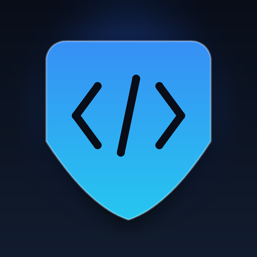

# secure-system-development




> **让 AI agent 在写代码之前就按安全规范执行，而不是上线之后补漏洞。**

一套可直接执行、可被 AI 读取的系统与网站开发规范。不是安全知识科普，而是**红线清单 + 可运行扫描器 + 评审模板**，装进 agent 后会在你写登录、建表、配路由、发布上线时自动提醒并阻断高危写法。

---

## 它解决什么问题

大多数安全事故不是"写错了某个函数"，而是**设计阶段就埋了雷**，等发现时改造成本极高：

| 会踩的坑 | 事后要付的代价 | 本 skill 在哪拦 |
|---|---|---|
| 登录接口没有限速 | 被撞库，全站账号泄露 | 红线清单·认证与会话 |
| 价格/折扣信任前端传值 | 1 元买到 1 万元商品 | 红线清单·业务逻辑与竞态 |
| 库存"先查再减" | 超卖，赔钱或丢客户 | 数据库高并发·条件更新 |
| SPA 未知路径全回落 `index.html` | 搜索引擎收录大量垃圾页 | 发布前清单 + 扫描器 ROUTE001 |
| 后台/内部系统被搜索引擎收录 | 管理入口暴露，成为攻击目标 | 场景判定·禁止收录 |
| `Access-Control-Allow-Origin: *` 还带 Cookie | 任意站点可读取用户数据 | 扫描器 CORS001/CORS002 |
| 接口参数明文可改 | 改包刷单、越权查别人订单 | 接口完整性·签名与防重放 |
| 密码用 MD5 / `Math.random()` 生成 token | 彩虹表直接破、凭证可预测 | 扫描器 CRYPTO001/CRYPTO002 |
| 密钥写进前端 bundle | 一旦公开，云资源被盗刷 | 扫描器 SECRET001-006 |
| 交给 AI 写代码，AI 图省事拼接 SQL | 注入漏洞批量产生 | 红线清单 + 扫描器 SQL001/004/005 |

**更根本的问题**：安全规范通常写在 Wiki 里，人和 AI 都不会主动去读。这个 skill 把规范变成了 agent 的默认行为。

---

## 它有什么用

| 阶段 | 你能得到什么 | 对应文件 |
|---|---|---|
| **设计** | 5 分钟威胁建模：项目类型判定、数据流、信任边界、STRIDE、9 项必填结论 | `assets/threat-model-template.md` |
| **编码** | 9 组硬性红线，覆盖认证、注入、并发、异步、业务逻辑、密钥、AI、移动端、HTTP | `SKILL.md` |
| **自查** | 18 条规则的扫描器，支持 text/JSON/SARIF，可直接接 CI 阻断 | `scripts/scan_redlines.py` |
| **上线前** | 按项目类型分组勾选（公开站点 / 产品 / 后台 / 内部系统 / 纯 API） | `assets/review-checklist.md` |
| **合规** | OWASP Top 10、ASVS 4.0.3、等保 2.0 三级、PIPL 逐条映射 | `references/compliance-mapping.md` |

**一句话总结用途**：让 agent 交付的代码默认具备生产级安全基线，把"事后渗透测试才发现"变成"写的时候就避开"。

---

## 覆盖范围

| 主题 | 关键内容 | 文件 |
|---|---|---|
| 认证与会话 | 密码哈希、防爆破、防枚举、会话轮换、JWT、2FA、重置、CSRF、越权、后台加固 | `references/auth-and-session.md` |
| 注入与输出 | SQLi、XSS、SSRF、路径穿越、上传、命令执行、反序列化、响应头、API 特有风险 | `references/web-vulnerability-prevention.md` |
| 业务逻辑与竞态 | 价格篡改、优惠券、库存、状态机、TOCTOU、限购、导出滥用、邀请防刷 | `references/business-logic-and-race-conditions.md` |
| 数据库高并发 | 索引、事务、锁、条件更新、幂等键、缓存三件套、连接池、分库分表 | `references/database-concurrency.md` |
| 异步架构 | 超时、重试退避、队列幂等、Outbox、背压、优雅停机、可观测性 | `references/async-architecture.md` |
| HTTP 与收录 | 真 404、状态码、CORS 白名单、缓存、公开站点 SEO、后台禁止收录 | `references/http-routing-cors-seo.md` |
| 密钥与运维 | 密钥轮换、CI/CD、容器云、邮件域 SPF/DKIM/DMARC、审计日志、应急 | `references/operations-and-secrets.md` |
| 接口防篡改 | 请求签名、服务端重算、响应签名、防重放、证书固定、加固边界 | `references/api-integrity-and-tampering.md` |
| AI / LLM | 提示注入、工具调用权限、RAG 投毒、模型输出处理、成本限流 | `references/ai-llm-security.md` |
| 移动端与小程序 | Keychain/Keystore、证书固定、WebView、小程序 session_key | `references/mobile-and-miniprogram.md` |
| 合规映射 | OWASP / ASVS / 等保 2.0 / PIPL 对照表 | `references/compliance-mapping.md` |

---

## 快速开始

### 1. 跑一次扫描（30 秒）

```bash
git clone https://github.com/bucai2417/bucai-skills.git
cd bucai-skills/secure-system-development
python scripts/scan_redlines.py <你的项目目录> --format text
```

示例输出：

```
src/api/user.js:42:18  [SQL001] HIGH  Possible SQL string concatenation (left) - use parameterized queries/ORM binding
    > const rows = await db.query("SELECT * FROM users WHERE id = '" + id + "'");
    fix: references/web-vulnerability-prevention.md#2-sql-注入
```

### 2. 接进 CI（高危阻断合并）

```yaml
- run: python scripts/scan_redlines.py ./src --format sarif --fail-on high > redlines.sarif
```

### 3. 装进你的 AI agent

本 skill 位于 [bucai-skills](../) 仓库。推荐用根目录安装脚本：

```bash
git clone https://github.com/bucai2417/bucai-skills.git
cd bucai-skills
./install.sh secure-system-development                 # 默认装到 ~/.Claud/skills
./install.sh --target codex secure-system-development  # 装到 ~/.codex/skills
```

Claud / Claud Code 手动安装：

```bash
cp -r secure-system-development ~/.Claud/skills/
```

> Windows 上该目录可能显示为 `%USERPROFILE%\.Claud\skills\` 或 `%USERPROFILE%\.claud\skills\`，二者指向同一位置。

Codex：

```bash
cp -r secure-system-development ~/.codex/skills/
```

其他支持 Skills 的 agent：复制目录到其 skills 路径，或在项目 `AGENTS.md` 中引用 `SKILL.md`。

安装后，当你提到"写个登录接口""设计订单表""配一下 CORS""这个后台要不要做 SEO"时，agent 会自动加载规范并按红线清单自查。
---

## 扫描器

18 条规则，纯 Python 标准库，无第三方依赖（Python 3.7+）。

| 规则组 | 检测内容 |
|---|---|
| SQL001/004/005 | 字符串拼接 SQL、f-string/模板字符串插值 |
| XSS001/002 | `innerHTML`、`dangerouslySetInnerHTML`、`eval`、`new Function` |
| TEMPLATE001 | 服务端模板字符串渲染（SSTI） |
| CORS001/002 | `Access-Control-Allow-Origin: *`、反射请求 Origin |
| ROUTE001-003 | Express 通配路由、Nginx 无条件回落、404 重定向首页 |
| SECRET001-006 | AWS/GitHub/Slack/Google 密钥、私钥、通用硬编码凭证 |
| CMD001 | 命令执行拼接 |
| NET001 | 关闭 TLS 证书校验 |
| DEBUG001 | 生产环境开启调试 |
| UPLOAD001 | 上传文件名直接参与路径拼接 |
| NOSQL001 | NoSQL 操作符注入 |
| CRYPTO001/002 | MD5/SHA1 存密码、`Math.random()` 生成凭证 |
| LOG001 | 敏感字段写入日志 |
| CMP001 | `==` 比较签名（应恒定时间比较） |

```bash
python scripts/scan_redlines.py ./src                          # 人读
python scripts/scan_redlines.py ./src --format json            # 机器读
python scripts/scan_redlines.py ./src --format sarif --fail-on high   # CI
python scripts/scan_redlines.py ./src --code-only              # 跳过文档
python scripts/scan_redlines.py ./src --min-severity medium    # 只看中高危
```

误报抑制（在该行末尾）：

```js
eval(safeAst); // redline: ignore
eval(other);   // redline: ignore XSS002
```

---

## 目录结构

```
secure-system-development/
├── SKILL.md                    agent 主入口：场景判定 + 红线清单 + 四阶段
├── README.md                   本文件
├── AGENTS.md                   不支持 Skills 的 agent 的入口
├── CHANGELOG.md                版本记录
├── LICENSE                     MIT
├── agents/openai.yaml          Codex/OpenAI interface 描述（含图标）
├── .codex-plugin/plugin.json   Codex 插件元数据
├── scripts/scan_redlines.py    红线扫描器
├── assets/                     威胁建模模板、评审清单、icon-512.png
├── references/                 12 个专题文档
├── tests/                      扫描器自测
└── tools/                      打包与图标生成工具
```

> CI 与自动发布工作流统一放在 [bucai-skills 仓库根目录](../.github/workflows/)，
> 本 skill 目录内不再单独维护 `.github/`。

---

## 上架 Skill 平台

平台要求 `SKILL.md` 顶层带 `display_name`、`display_name_en`、`description`、`description_zh`、`description_en`、`version`、`author`，并提供一张 512×512 图标。本仓库已满足：

| 平台要求 | 本仓库 |
|---|---|
| 顶层 `display_name` / `display_name_en` | ✅ 安全系统开发规范 / Secure System Development |
| 顶层 `description` / `description_zh` / `description_en` | ✅ 均在 frontmatter |
| 顶层 `version` / `author` | ✅ `1.2.1` / `bucai2417` |
| `description` ≤1024 字符、无尖括号 | ✅ |
| 512×512 图标，≤500 KB | ✅ `assets/icon-512.png`（52 KB） |
| zip 解压后 `SKILL.md` 在第一层 | ✅ `tools/package_skill.py` 产物 |
| 包体 ≤3 MB | ✅ 约 80 KB |

上传用平台精简包（自动剔除 `.codex-plugin/`、`agents/`、`.gitignore` 等非平台文件）：

```bash
python tools/package_skill.py --out dist
# 上传 dist/secure-system-development-<version>.zip
```

重新生成图标：

```bash
python tools/make_icon.py
```

---

## 版本与发布

- **skill 版本唯一来源**：`SKILL.md` 顶层的 `version` 字段
- 查看当前版本：

```bash
python tools/package_skill.py --src . --print-version
```

- 本地单独打包（生成 `.skill`、`.zip`、Codex 插件包）：

```bash
python tools/package_skill.py --src . --out dist
```

- 随集合发布新版本（在 bucai-skills 仓库根目录）：

```bash
# 1. 改本目录 SKILL.md 的 version 与 CHANGELOG.md
# 2. 改根目录 VERSION（集合版本）
# 3. 提交并打集合 tag
git add -A
git commit -m "feat: ..."
git tag v1.1.0
git push origin main v1.1.0
```

Release 工作流会：校验 tag 与根目录 `VERSION` 一致 → 校验全部 skill →
跑扫描器自测 → 构建包含全部 skill 的 `bucai-skills-<version>.zip` →
创建 GitHub Release。单个 skill 的打包脚本仍可用于本地分发，但正式发布以集合包为准。

更详细的发布说明见 [`docs/publishing.md`](docs/publishing.md)。

---

## 设计取向

- **场景分流**：收录规则按项目类型区分。只有官网、博客、文档这类公开站点做 SEO；后台、内部系统、个人工具、纯 API 应整站 noindex。
- **规则可执行**：每条红线都能落到具体代码或配置，不给"注意安全"这类空话。
- **解释原因**：说明"为什么"，便于在边界情况下判断，而不是机械遵守。
- **合规是下限**：通过 ASVS 不代表安全，只代表没有明显遗漏。

---

## 贡献

欢迎提交 Issue / PR。提交前请本地跑：

```bash
python tools/package_skill.py --check-only
python tests/test_scanner_rules.py
python scripts/scan_redlines.py . --code-only --exclude tests --fail-on high
```

## 许可

[MIT](LICENSE) © 2026 bucai2417
